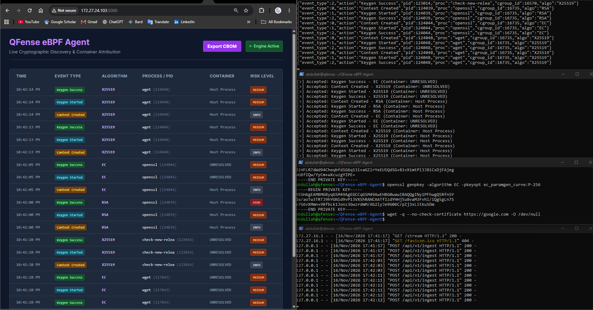
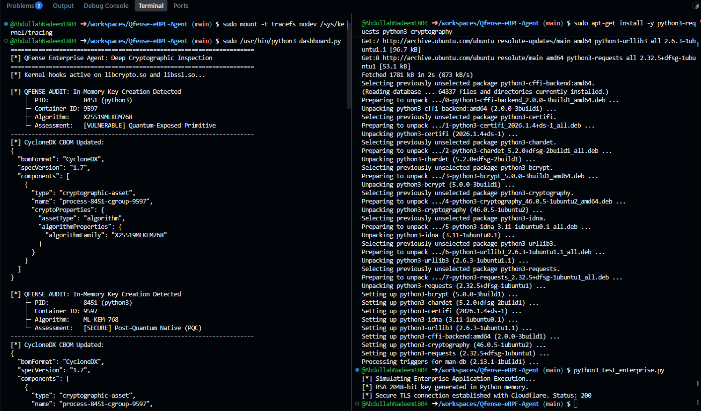

# QFense eBPF Agent

> Runtime Cryptographic Observability and Post-Quantum Readiness for Kubernetes

[](https://opensource.org/licenses/MIT)
[](https://ebpf.io/)
[](https://cyclonedx.org/)

## Overview

QFense is an open-source, Kubernetes-native eBPF agent for runtime cryptographic observability. It is designed to help identify cryptographic operations running inside Linux workloads and provide visibility into cryptographic assets that may need to be migrated to Post-Quantum Cryptography (PQC).

The project focuses on the **Harvest Now, Decrypt Later (HNDL)** threat, where attackers collect encrypted traffic today with the expectation of decrypting it using future quantum computing capabilities.

Traditional static analysis tools inspect source code, dependencies, and configuration files. However, they cannot reliably identify cryptographic operations occurring at runtime, especially when keys are generated dynamically or applications run inside containerized environments.

QFense addresses this visibility gap by using eBPF Uprobes to observe supported OpenSSL cryptographic operations at runtime, associate events with process and container metadata, and generate CycloneDX 1.7 Cryptographic Bills of Materials (CBOMs).

The goal is to provide a runtime inventory of cryptographic activity across Kubernetes workloads and make PQC migration assessments more evidence-based.

---

## Architecture

QFense uses a decoupled architecture consisting of three main components:

1. **Sensor (eBPF and CO-RE C Agent)**

   A lightweight, precompiled C agent runs as a Kubernetes DaemonSet. It uses eBPF Uprobes to instrument supported OpenSSL functions, captures events through a BPF Ring Buffer, and outputs structured JSON logs to `stdout`.

2. **Bridge (Python)**

   The Python bridge consumes Kubernetes agent logs, parses the JSON events, and resolves host PIDs to container IDs using the `/proc` filesystem.

3. **Control Plane (Flask and SQLite)**

   The Flask control plane receives structured events, applies the evidence-aware risk engine, stores event data in SQLite, and exposes the information through a real-time web dashboard.

### Architecture Diagram

```text
                                ┌────────────────────────────────────────────────────────────┐
                                │                     User-Space Workloads                   │
                                │        OpenSSL • Python • Nginx • Microservices            │
                                └───────────────────────┬────────────────────────────────────┘
                                                        │
                                                        ▼
                                              Uprobe: libcrypto.so.3
                                                        │
                                                        ▼
                                ┌────────────────────────────────────────────────────────────┐
                                │                       Linux Kernel                         │
                                │   ┌─────────────────────────┐   ┌────────────────────────┐ │
                                │   │ Semantic Context Map    │   │ BPF Ring Buffer        │ │
                                │   └────────────┬────────────┘   └────────────┬───────────┘ │
                                │                └──────────────┬──────────────┘             │
                                │                               ▼                            │
                                │                 CO-RE C Agent (DaemonSet)                  │
                                └───────────────────────────────┬────────────────────────────┘
                                                                │
                                                                ▼ (Structured JSON Logs)
                                ┌────────────────────────────────────────────────────────────┐
                                │                  QFense Control & UI Layer                 │
                                │  • Python Bridge (Parses JSON)                             │
                                │  • Container Attribution (/proc cgroup)                    │
                                │  • Evidence-Aware Risk Engine (INFO/MEDIUM/HIGH)           │
                                │  • Dynamic CycloneDX 1.7 CBOM generation                   │
                                │  • Live Server-Sent Events (SSE) dashboard                 │
                                └────────────────────────────────────────────────────────────┘
```

### Telemetry Pipeline

The runtime telemetry pipeline works as follows:

1. QFense attaches eBPF Uprobes to supported OpenSSL functions, including `EVP_PKEY_CTX_new_from_name` and `EVP_PKEY_generate`.
2. The CO-RE C agent captures relevant events in kernel space and writes them to a BPF Ring Buffer.
3. The agent reads events from the buffer and outputs structured JSON to `stdout`, which is available through Kubernetes container logs.
4. The Python bridge consumes these logs, parses the JSON payloads, and resolves host PIDs to container IDs using `/proc/<pid>/cgroup`.
5. The Flask control plane receives the events, applies the risk classification logic, stores the results, and streams updates to the dashboard using Server-Sent Events (SSE).

---

## Runtime Event Classification

One of the main design considerations in QFense is distinguishing between cryptographic intent and actual cryptographic execution.

A process requesting an algorithm context does not necessarily mean that a cryptographic key has been generated. Treating both events equally would introduce unnecessary alerts and inaccurate asset reporting.

The current risk engine uses the following classifications:

| Event | Severity | Description |
|---|---|---|
| Context Created | INFO | OpenSSL requested an algorithm context. No key generation has been confirmed. |
| Keygen Started | MEDIUM | A key generation operation has started, but successful completion has not yet been confirmed. |
| Keygen Success | HIGH | Key generation completed successfully. The generated key may represent a quantum-vulnerable cryptographic asset. |
| PQC_OBSERVED | INFO | A supported post-quantum algorithm, such as ML-KEM, was observed. Its presence alone does not establish secure configuration. |

This approach makes the inventory more meaningful by associating risk classifications with observed execution evidence rather than simply detecting algorithm references.

---

## Process and Container Attribution

The Python bridge uses kernel process identifiers to associate cryptographic events with their originating workloads.

It reads `/proc/<pid>/cgroup` to identify the container associated with a process.

The attribution logic currently handles three scenarios:

- **Container Identified:** When a matching container ID is found, QFense records the container identifier. The dashboard displays its 12-character short form, such as `a1b2c3d4e5f6`.
- **Host Process:** When the process runs directly on the host VM rather than inside a container, it is identified as `Host Process`.
- **UNRESOLVED:** When a short-lived process exits before the bridge can inspect its `/proc` entry, the container attribution cannot be completed. QFense reports `UNRESOLVED` instead of assigning an incorrect container ID.

The unresolved state is intentional. It preserves the distinction between confirmed attribution and events for which process metadata is no longer available.

---

## Container Library Isolation

The current implementation instruments the host's OpenSSL 3 library.

Containerized applications may use their own isolated copies of `libcrypto.so.3`. As a result, OpenSSL operations executed inside a pod are not necessarily visible to the current host-level instrumentation.

Addressing this requires dynamic library discovery and tracking of library-loading activity, including `openat` syscall events.

This functionality is currently part of the project roadmap.

---

## Runtime Monitoring

QFense captures cryptographic activity during execution and forwards the resulting events through the telemetry pipeline.

The following screenshot shows the Kubernetes agent logs, Python bridge processing, process attribution, and Flask dashboard.



---

## CycloneDX Cryptographic Bill of Materials

QFense aggregates detected cryptographic activity and exports a machine-readable CycloneDX 1.7 Cryptographic Bill of Materials (CBOM).

The generated CBOM contains cryptographic asset information, including algorithm-related metadata and associated workload information.



---

## Performance Benchmarking

A preliminary benchmark was performed to evaluate the overhead introduced by the eBPF Uprobe instrumentation.

The benchmark measured the execution time required to generate 100 RSA-2048 keys using OpenSSL. Five runs were performed, and the median execution time was recorded.

| Configuration | Execution Time |
|---|---:|
| Baseline (Agent Disabled) | 25.9s |
| Agent Enabled | 25.8s |
| Measured Overhead | < 1% |

**Note:** This benchmark covers host-level RSA key generation only. High-throughput TLS benchmarking is still ongoing. The measured difference is within typical OS caching and execution-time variation.

---

## Getting Started

### Prerequisites

The current implementation requires:

- Linux kernel 5.15 or later with BTF support.
- A Kubernetes cluster (K3s is recommended for local testing).
- `kubectl` configured with access to the target cluster.
- Python 3 installed on the host running the control plane.
- OpenSSL 3 for the demonstration workload.

### 1. Deploy the eBPF Agent

Apply the Kubernetes DaemonSet:

```bash
sudo kubectl apply -f daemonset.yaml
```

Verify that the agent pods are running:

```bash
sudo kubectl get pods -n kube-system -l app=qfense-agent
```

### 2. Start the Flask Control Plane

On the host VM, open two separate terminals.

**Terminal 1: Start the dashboard**

```bash
python3 web_dashboard.py
```

**Terminal 2: Start the Python bridge**

```bash
python3 bridge.py
```

The bridge consumes the Kubernetes agent logs and forwards parsed events to the Flask control plane.

### 3. Generate a Demonstration Event

Open a third terminal and execute an RSA-2048 key generation operation on the host VM:

```bash
openssl genpkey -algorithm RSA -pkeyopt rsa_keygen_bits:2048
```

This generates a key and triggers the supported OpenSSL instrumentation.

Open the following URL to access the dashboard:

[http://localhost:5000](http://localhost:5000)

---

## Current Limitations

The current implementation has several limitations that are important to consider when evaluating its capabilities.

### 1. Container Library Isolation

The CO-RE agent currently attaches to the host's OpenSSL library:

```text
/host/lib/x86_64-linux-gnu/libcrypto.so.3
```

OpenSSL operations executed inside a pod using its own isolated library are not currently guaranteed to be intercepted.

Dynamic library discovery and `openat` syscall tracking are planned to address this limitation.

### 2. Cryptographic Library Support

Currently, instrumentation is implemented for OpenSSL 3.

The following libraries are not yet supported:

- BoringSSL
- GnuTLS
- NSS

### 3. Privileged Execution

The Kubernetes agent currently requires:

- `hostPID: true`
- Privileged container access

These permissions are used for the current eBPF instrumentation approach and should be reviewed before deploying the agent in production environments.

### 4. Production Hardening

The current implementation is primarily intended for development, experimentation, and evaluation.

The following production-hardening components are not yet complete:

- Mutual TLS (mTLS) between the bridge and dashboard.
- Fine-grained Kubernetes RBAC.
- Container image signing and verification.
- Additional security controls for multi-node deployments.

---

## Roadmap

### Completed

- [x] eBPF Uprobes on OpenSSL 3 (`libcrypto.so`)
- [x] Context vs. Keygen semantic distinction
- [x] CycloneDX 1.7 CBOM generation
- [x] Kubernetes DaemonSet deployment
- [x] CO-RE migration using libbpf
- [x] Evidence-aware risk engine
- [x] Python-based Kubernetes log bridge
- [x] Flask dashboard with SSE event streaming
- [x] Process and container attribution

### Planned

- [ ] In-container dynamic library discovery (`openat` tracking)
- [ ] Envoy / GnuTLS memory-hook support
- [ ] Centralized multi-node control plane (PostgreSQL/gRPC)

---

## Project Structure

```text
QFense-eBPF-Agent/
├── assets/
│   ├── kubernetes-pipeline.png
│   └── cbom-output.png
├── core-agent/
│   ├── Makefile
│   └── Dockerfile
├── templates/
│   └── Flask HTML/JS templates
├── bridge.py
├── daemonset.yaml
├── web_dashboard.py
└── README.md
```

---

## Contributing

Contributions, experiments, and bug reports are welcome.

Before submitting a pull request:

1. Test changes on a supported Linux environment.
2. Document any kernel or OpenSSL compatibility requirements.
3. Update the documentation when behavior changes.
4. Include relevant test results for changes affecting event collection or risk classification.
5. Keep changes consistent with the existing architecture.

---

## License

This project is licensed under the [MIT License](https://opensource.org/licenses/MIT).
